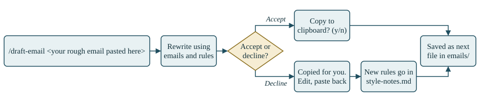

# client-email

Turn a rough email into one that sounds like you wrote it, using emails you have already sent to the same client as examples. Every email you finish is added to the examples, so the next one starts closer.

It runs inside Claude Code. There is no code to install, only text files.

## How it works

<p align="center">
  
</p>

## Files

```
client-email/
├── README.md                # this page
├── CLAUDE.md                # short project description Claude reads on start
├── style-notes.md           # style rules, one per line
├── how-it-works.svg         # the diagram above
├── .claude/
│   └── skills/
│       └── draft-email/
│           └── SKILL.md     # the steps Claude follows, in plain English
└── emails/
    ├── 001.txt              # three example emails to the client, Priya
    ├── 002.txt
    └── 003.txt              # each email you finish is added here as 004, 005...
```

## Run it

You need a Mac and [Claude Code](https://claude.com/claude-code).

<table>
<tr><th width="8%">Step</th><th width="52%">Type this</th><th width="40%">What happens</th></tr>
<tr><td>1</td><td>

```
git clone https://github.com/ayubAz/client-email.git
```

</td><td>Downloads the project</td></tr>
<tr><td>2</td><td>

```
cd client-email
```

</td><td>Moves into the folder</td></tr>
<tr><td>3</td><td>

```
claude
```

</td><td>Starts Claude Code</td></tr>
<tr><td>4</td><td>

```
/draft-email site is ready, ask priya to check it
```

</td><td>Shows the rewritten email</td></tr>
<tr><td>5a</td><td>

```
accept
```

</td><td>Offers to copy it to your clipboard</td></tr>
<tr><td>5b</td><td>

```
decline
```

</td><td>Copies it. Edit it and paste it back</td></tr>
<tr><td>6</td><td>

```
! ls emails
```

</td><td>Lists the folder. New file, <code>004.txt</code></td></tr>
</table>

## What works and what doesn't

| Part | Status |
|---|---|
| Rewrite a draft from the examples | Works |
| Accept or decline, copy to clipboard | Works |
| Save the final email to `emails/` | Works |
| Read rules from `style-notes.md` | Works |
| Write new rules to `style-notes.md` when you decline | Works |
| Ask you before saving a new rule | Not built. Step 1 |
| Tell you what it changed | Not built. Step 2 |
| Cope with a large number of examples | Not built. Step 3 |

## Finish the build

All of these are edits to `.claude/skills/draft-email/SKILL.md`. You write instructions, not code.

### Step 1: Approve rules before they are saved

**Why:** when you decline, rules are written to `style-notes.md` without asking. A wrong rule affects every email after it.

| Step | What to do |
|---|---|
| 1 | Open `SKILL.md`. |
| 2 | In step 6, find the line that adds rules to `style-notes.md`. |
| 3 | Change it so each new rule is shown to you first with the question `Save this rule? (y/n)`. |
| 4 | Add that only the rules you say yes to are saved. |
| 5 | Save the file and start a new Claude session. |
| 6 | Test it. Decline a draft, swap "Cheers" for "Thanks" and paste it back. You should be asked about a sign-off rule. Say no. `style-notes.md` should be unchanged. |

### Step 2: Show what changed

**Why:** you can't see why the rewrite came out the way it did.

| Step | What to do |
|---|---|
| 1 | Open `SKILL.md`. |
| 2 | Add a new step straight after step 3, where the rewrite is shown. |
| 3 | In it, ask for a list of what was changed from your rough draft. Three bullets at most. |
| 4 | Ask for each bullet to name the example or rule that caused the change. |
| 5 | Save the file and start a new Claude session. |
| 6 | Test it. Run `/draft-email`. Each bullet should point to an example file or a rule you can find. |

### Step 3: Limit the examples

**Why:** every run reads every email. At 200 emails that is slow and costly.

| Step | What to do |
|---|---|
| 1 | Open `SKILL.md`. |
| 2 | Change step 1 so it reads only the 10 newest files in `emails/`. |
| 3 | Add a line that keeps `style-notes.md` under 15 rules by merging duplicates. |
| 4 | Save the file and start a new Claude session. |
| 5 | Test it. Make sure `emails/` has 11 or more files, then add a `000.txt` written in a very different style. Run `/draft-email`. The result should not pick up that style. |

### If you have time

| Step | What to do |
|---|---|
| 4 | **More than one client.** Give each client a folder. |
| 5 | **Real examples.** Replace the three made-up emails with three from your sent mail. |
| 6 | **Remove a bad example.** Add a way to delete one from `emails/`. |
